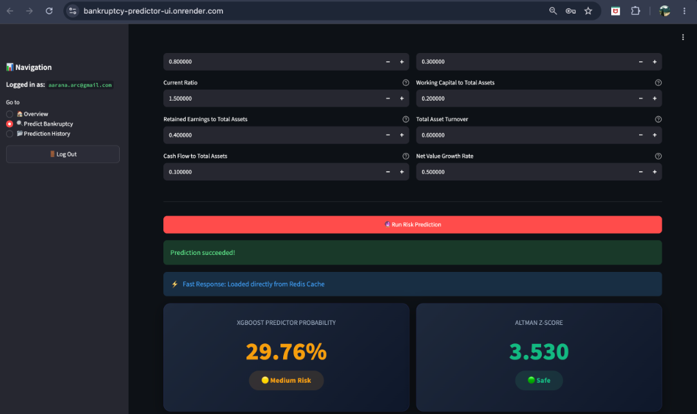

# Corporate Bankruptcy Prediction System

An XGBoost-powered corporate bankruptcy prediction system (class imbalance handled with `scale_pos_weight`, no resampling), benchmarked against the classical Altman Z-Score, interpreted with SHAP, utilizing Redis caching, and integrated with Supabase database for user authentication and prediction history logging.

**[Live Demo Link](https://bankruptcy-predictor-ui.onrender.com/)**



---

## Architecture Overview

This decoupled application separates frontend presentation from model inference and database layers:

- **Streamlit UI**: Pure presentation layer. Communicates with the backend exclusively via JSON HTTP APIs with JWT bearer authentication.
- **FastAPI Backend**: Hosts the XGBoost classifier pipeline, handles password hashing and JWT validation, interacts with Supabase, and manages Redis caching.
- **Redis Cache**: Caches predictions to bypass model inference for identical inputs.
- **Supabase Postgres**: Stores hashed user credentials and historical predictions.

---

## Model Performance

<!-- metrics:start -->
5×5 repeated stratified cross-validation on all 6,819 firms (220 bankrupt, base rate 3.2%). Values are mean ± std over 25 test folds; preprocessing, calibration and everything else are fitted inside each training fold. The old README used one 80/20 split with only 44 bankrupt firms in its test set.

| Model | ROC-AUC | PR-AUC | Brier | Recall @ 0.50 (uncalibrated) |
|-------|---------|--------|-------|------------------------------|
| Altman Z-Score (1968), scored as −Z | 0.909 ± 0.012 | 0.296 ± 0.042 | — | — |
| Logistic Regression (standardised, balanced weights) | 0.896 ± 0.030 | 0.355 ± 0.058 | 0.0890 ± 0.0061 | 78.5% ± 5.0% |
| Random Forest (balanced weights) | 0.940 ± 0.012 | 0.426 ± 0.062 | 0.0256 ± 0.0021 | 36.8% ± 5.7% |
| XGBoost + `scale_pos_weight`, unconstrained | 0.941 ± 0.012 | 0.439 ± 0.068 | 0.0693 ± 0.0045 | 79.9% ± 6.5% |
| XGBoost + `scale_pos_weight`, monotone constraints | 0.941 ± 0.011 | 0.436 ± 0.062 | 0.0746 ± 0.0049 | 81.3% ± 5.6% |
| **Monotone-constrained XGBoost + sigmoid calibration (deployed)** | **0.941 ± 0.011** | **0.436 ± 0.062** | **0.0236 ± 0.0010** | see threshold below |

**Cost of the monotone constraints** (19 features, `config/monotone_constraints.json`), paired by fold: ROC-AUC +0.0003 (± 0.0017), PR-AUC -0.0030 (± 0.0250). The raw Brier score is not comparable before calibration because `scale_pos_weight` inflates probabilities.

**Calibration:** sigmoid (rule: isotonic only if its mean paired Brier gain over sigmoid exceeds the std of that gain). Brier score of the calibrated PD 0.0236 ± 0.0010 vs 0.0746 ± 0.0049 uncalibrated. Reliability plot: `reports/calibration.png`.

**Decision threshold:** 0.150, the PD that minimises expected cost when a missed default costs 10× a false alarm (theory for perfectly calibrated PDs: 0.091). At this threshold: precision 30.8% ± 3.0%, recall 70.9% ± 6.6%, 7.5% ± 0.9% of firms flagged. At 0.50 the calibrated model catches 0.0% ± 0.0% of defaults.

| Grade | PD band | Firm-predictions | Defaults | Observed default rate | Mean predicted PD |
|-------|---------|------------------|----------|-----------------------|-------------------|
| A | < 1% | 26,034 | 77 | 0.3% | 0.4% |
| B | < 3% | 2,798 | 84 | 3.0% | 1.7% |
| C | < 10% | 2,059 | 107 | 5.2% | 5.8% |
| D | < 30% | 1,791 | 240 | 13.4% | 18.6% |
| E | < 100% | 1,413 | 592 | 41.9% | 38.6% |

Grades rank risk in order: **yes**. Counts pool all 5 repeats, so each firm appears 5 times.

> **Altman Z-Score:** Ratios are 0-1 normalised in this dataset, so Z values and the 1.81/2.99 zones are not interpretable; only the ranking (AUC) is reported. Lower Z means more risk, so the score is negated before computing AUC.
>
> **Caveat:** XGBoost hyperparameters (config/risk_policy.json) were tuned in the notebook on an 80/20 split that overlaps these CV test folds, so XGBoost rows are slightly optimistic (no nested CV).
> **Caveat:** The cost threshold is chosen on the same pooled out-of-fold PDs it is evaluated on; compare it with the Bayes-optimal threshold 1/(1+cost_ratio), which uses no data.
> **Caveat:** Grade boundaries are policy (config/risk_policy.json); grade counts pool all 5 repeats, so each firm appears 5 times.
> **Caveat:** Recall at a fixed 0.50 threshold is not comparable across uncalibrated models; compare ROC-AUC / PR-AUC.

<sub>Generated by `python -m training.render_readme` from `reports/metrics.json` (`training/cv_evaluate.py`, commit `f211501`, 2026-11-05T07:43:05+00:00).</sub>
<!-- metrics:end -->

Reproduce: `python -m training.cv_evaluate && python -m training.train_model && python -m training.render_readme`. What changed and why: [docs/LEARNING.md](docs/LEARNING.md).

### API

| Endpoint | Auth | What it returns |
|----------|------|-----------------|
| `POST /predict` | JWT | Calibrated PD, grade A–E, the cost-based `threshold` and `flagged`, top-10 SHAP factors (log-odds) for a waterfall. Cached in Redis, logged to Supabase. |
| `POST /predict/batch` | JWT | PD, grade and top-3 factors for up to 500 firms (portfolio upload). |
| `POST /predict/counterfactual` | JWT | Smallest change to 1–3 adjustable ratios (bounded to the training data's 1st–99th percentile) that reaches a target grade. |
| `POST /predict/stress` | JWT | PD before and after shocks; lists every ratio each shock touched. |
| `GET /predict/history` | JWT | The user's past predictions from Supabase. |
| `GET /meta` | none | Grades, threshold, adjustable ratios and stress shocks (policy only, no secrets). |
| `POST /auth/signup`, `POST /auth/login` | none | JWT bearer token. |

---

## Project Structure

```text
app/
├── __init__.py
├── main.py                     # Entry point combining routers, middlewares, and CORS
├── models/
│   ├── model.joblib            # Serialized XGBoost ML model
│   └── robust_scaler.pkl, winsorize_bounds.pkl, etc.
├── api/
│   ├── routes_predict.py       # Predict endpoints with Redis & Supabase prediction logging
│   └── routes_auth.py          # /auth/signup & /auth/login with Supabase users
├── core/
│   ├── config.py               # Env var loading via dotenv
│   ├── security.py             # Password hashing (bcrypt) & JWT token helpers
│   ├── dependencies.py         # DB (Supabase client) and Current User retrieval
│   └── exceptions.py           # Custom exception handler classes
├── services/
│   └── model_service.py        # Pipeline: load artifacts, winsorize, scale, predict, SHAP top factors
├── middleware/
│   └── logging_middleware.py   # Global HTTP request/response logging
├── cache/
│   └── redis_cache.py          # Redis client cache helper
└── utils/
    └── logger.py               # Clean stdout logging formatter
streamlit_app.py                # Streamlit UI client
training/
├── __init__.py
├── train_utils.py              # Winsorization & scaling helper functions
├── train_model.py              # XGBoost training pipeline script (outputs to app/models/)
├── cv_evaluate.py              # 5×5 repeated stratified CV → reports/metrics.json
└── render_readme.py            # Writes the README metrics table from reports/metrics.json
reports/metrics.json            # Every metric shown in the README and UI comes from here
tests/                          # pytest: auth helpers, cache key, /predict (Supabase/Redis faked)
```

---

## Setup & Running Locally

### 1. Configure the Environment
Copy `.env.example` to `.env` at the root of the project and fill it in:
```ini
SUPABASE_URL=https://your-supabase-project.supabase.co
SUPABASE_KEY=your-supabase-anon-key
REDIS_URL=redis://localhost:6379
JWT_SECRET_KEY=your-custom-jwt-signing-secret   # required: the API refuses to start without it
ALLOWED_ORIGINS=http://localhost:8501           # optional: comma-separated CORS origins (default shown)
```
Generate a secret with `python -c "import secrets; print(secrets.token_urlsafe(32))"`. The Streamlit UI calls the API server-to-server, so CORS only matters for browser clients.

### 2. Prepare Database Tables
Run the following SQL in your Supabase SQL Editor:
```sql
create table users (
    id uuid default gen_random_uuid() primary key,
    email text unique not null,
    password_hash text not null,
    created_at timestamp with time zone default timezone('utc'::text, now()) not null
);

create table predictions (
    id uuid default gen_random_uuid() primary key,
    user_id uuid references users(id) on delete cascade not null,
    input_features jsonb not null,
    prediction_result jsonb not null,
    created_at timestamp with time zone default timezone('utc'::text, now()) not null
);
```

### 3. Start the Backend API
```bash
pip install -r requirements-dev.txt   # API + UI + training/test tools
uvicorn app.main:app --host 0.0.0.0 --port 8000
```

### 4. Start the Frontend UI
```bash
export BACKEND_URL="http://localhost:8000"
streamlit run streamlit_app.py
```
