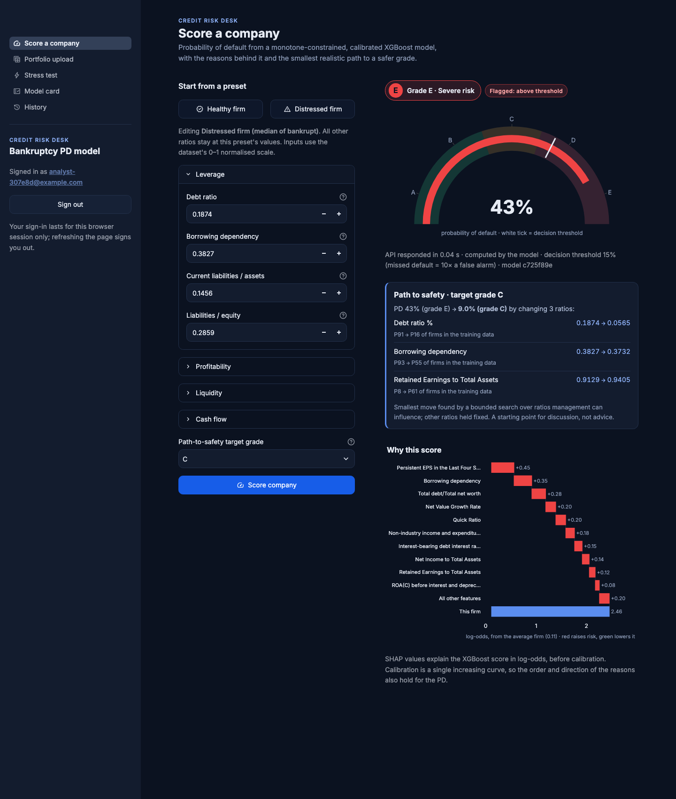

# Corporate Bankruptcy Prediction: a credit-risk desk

Probability-of-default (PD) model for listed companies, built on the UCI Taiwanese bankruptcy dataset (6,819 firms, 1999–2009). It's a **monotone-constrained XGBoost** (class imbalance handled with `scale_pos_weight`, no resampling), **calibrated** into a PD, with a **cost-based decision threshold**, **A–E risk grades**, SHAP explanations, a bounded **"path to safety"** counterfactual and **stress tests**. It's benchmarked against the Altman Z-Score. FastAPI + Streamlit, with JWT auth, Supabase logging and Redis caching. Python only.

**Live demo (Render, rollback host):** <https://bankruptcy-predictor-ui.onrender.com/>. Vercel hosting is configured but not yet deployed (see [docs/DEPLOYMENT.md](docs/DEPLOYMENT.md)).



More screenshots (desktop and phone width) are in [docs/verification/screenshots](docs/verification/screenshots). Plain-English notes and interview Q&A: [docs/LEARNING.md](docs/LEARNING.md).

---

## Architecture

- **Streamlit UI** (`streamlit_app.py` + `ui/`): five pages (Score a company, Portfolio upload, Stress test, Model card, History). It talks to the API only from the server side, through `ui/api.py`.
- **FastAPI** (`app/`): model service (preprocess → calibrated XGBoost → grade → SHAP), counterfactual and stress scenarios (`app/services/scenarios.py`), JWT auth, Supabase logging, optional Redis cache.
- **Hosting:** Vercel Services. Streamlit runs as a Python ASGI function, and the API as a private Container Runtime service reached through a service binding. Render (`render.yaml`) is kept as the rollback.
- **Policy as reviewed config:** `config/monotone_constraints.json` (constraint directions with reasons) and `config/risk_policy.json` (cost ratio, grade bands, adjustable ratios, stress shocks).

---

## Model Performance

<!-- metrics:start -->
5×5 repeated stratified cross-validation on all 6,819 firms (220 bankrupt, base rate 3.2%). Values are mean ± std over 25 test folds; preprocessing, calibration and everything else are fitted inside each training fold. The old README used one 80/20 split with only 44 bankrupt firms in its test set.

| Model | ROC-AUC | PR-AUC | Brier | Recall @ 0.50 (uncalibrated) |
|-------|---------|--------|-------|------------------------------|
| Altman Z-Score (1968), scored as −Z | 0.909 ± 0.012 | 0.296 ± 0.042 | — | — |
| Logistic Regression (standardised, balanced weights) | 0.896 ± 0.030 | 0.355 ± 0.058 | 0.0890 ± 0.0061 | 78.5% ± 5.0% |
| Random Forest (balanced weights) | 0.940 ± 0.012 | 0.426 ± 0.062 | 0.0256 ± 0.0021 | 36.8% ± 5.7% |
| XGBoost + `scale_pos_weight`, unconstrained | 0.941 ± 0.012 | 0.439 ± 0.068 | 0.0693 ± 0.0045 | 79.9% ± 6.5% |
| XGBoost + `scale_pos_weight`, monotone constraints | 0.941 ± 0.011 | 0.436 ± 0.062 | 0.0746 ± 0.0049 | 81.3% ± 5.6% |
| **Monotone-constrained XGBoost + sigmoid calibration (deployed)** | **0.941 ± 0.011** | **0.436 ± 0.062** | **0.0236 ± 0.0010** | see threshold below |

**Cost of the monotone constraints** (19 features, `config/monotone_constraints.json`), paired by fold: ROC-AUC +0.0003 (± 0.0017), PR-AUC -0.0030 (± 0.0250). The raw Brier score is not comparable before calibration because `scale_pos_weight` inflates probabilities.

**Calibration:** sigmoid (rule: isotonic only if its mean paired Brier gain over sigmoid exceeds the std of that gain). Brier score of the calibrated PD 0.0236 ± 0.0010 vs 0.0746 ± 0.0049 uncalibrated. Reliability plot: `reports/calibration.png`.

**Decision threshold:** 0.150, the PD that minimises expected cost when a missed default costs 10× a false alarm (theory for perfectly calibrated PDs: 0.091). At this threshold: precision 30.8% ± 3.0%, recall 70.9% ± 6.6%, 7.5% ± 0.9% of firms flagged. At 0.50 the calibrated model catches 0.0% ± 0.0% of defaults.

| Grade | PD band | Firm-predictions | Defaults | Observed default rate | Mean predicted PD |
|-------|---------|------------------|----------|-----------------------|-------------------|
| A | < 1% | 26,034 | 77 | 0.3% | 0.4% |
| B | < 3% | 2,798 | 84 | 3.0% | 1.7% |
| C | < 10% | 2,059 | 107 | 5.2% | 5.8% |
| D | < 30% | 1,791 | 240 | 13.4% | 18.6% |
| E | < 100% | 1,413 | 592 | 41.9% | 38.6% |

Grades rank risk in order: **yes**. Counts pool all 5 repeats, so each firm appears 5 times.

> **Altman Z-Score:** Ratios are 0-1 normalised in this dataset, so Z values and the 1.81/2.99 zones are not interpretable; only the ranking (AUC) is reported. Lower Z means more risk, so the score is negated before computing AUC.
>
> **Caveat:** XGBoost hyperparameters (config/risk_policy.json) were tuned in the notebook on an 80/20 split that overlaps these CV test folds, so XGBoost rows are slightly optimistic (no nested CV).
> **Caveat:** The cost threshold is chosen on the same pooled out-of-fold PDs it is evaluated on; compare it with the Bayes-optimal threshold 1/(1+cost_ratio), which uses no data.
> **Caveat:** Grade boundaries are policy (config/risk_policy.json); grade counts pool all 5 repeats, so each firm appears 5 times.
> **Caveat:** Recall at a fixed 0.50 threshold is not comparable across uncalibrated models; compare ROC-AUC / PR-AUC.

<sub>Generated by `python -m training.render_readme` from `reports/metrics.json` (`training/cv_evaluate.py`, commit `f211501`, 2026-11-05T07:43:05+00:00).</sub>
<!-- metrics:end -->

Reproduce: `python -m training.cv_evaluate && python -m training.train_model && python -m training.render_readme`. What changed and why: [docs/LEARNING.md](docs/LEARNING.md).

### API

| Endpoint | Auth | What it returns |
|----------|------|-----------------|
| `POST /predict` | JWT | Calibrated PD, grade A–E, the cost-based `threshold` and `flagged`, top-10 SHAP factors (log-odds) for a waterfall. Cached in Redis, logged to Supabase. |
| `POST /predict/batch` | JWT | PD, grade and top-3 factors for up to 500 firms (portfolio upload). |
| `POST /predict/counterfactual` | JWT | Smallest change to 1–3 adjustable ratios (bounded to the training data's 1st–99th percentile) that reaches a target grade. |
| `POST /predict/stress` | JWT | PD before and after shocks; lists every ratio each shock touched. |
| `GET /predict/history` | JWT | The user's past predictions from Supabase. |
| `GET /meta` | none | Grades, threshold, adjustable ratios and stress shocks (policy only, no secrets). |
| `POST /auth/signup`, `POST /auth/login` | none | JWT bearer token. |

---

## Project Structure

```text
app/                      FastAPI service (Docker image / Vercel container)
├── api/                  routes_predict.py (predict, batch, counterfactual, stress, history, meta), routes_auth.py
├── services/             model_service.py, risk.py (grades, cost threshold), scenarios.py (counterfactual, stress)
├── core/ cache/ middleware/ utils/
└── models/               calibrated model, scaler, winsor bounds, feature_quantiles.json, model_meta.json
config/                   monotone_constraints.json, risk_policy.json (reviewed policy)
training/                 cv_evaluate.py → reports/, train_model.py → app/models/, render_readme.py
reports/                  metrics.json + calibration.png: every number in the README and UI comes from here
streamlit_app.py          page config + navigation only
ui/                       api.py (server-side client), components.py, theme.py (Plotly template), styles.css, pages/
server.py, api/index.py   Streamlit as an ASGI app for Vercel
vercel.json, Dockerfile   Vercel services (web + api container); render.yaml = rollback
scripts/                  demo_api.py (in-memory DB, local only), screenshots.py
tests/                    pytest: API contract, auth, model, scenarios; tests/frontend: AppTest + client
docs/                     LEARNING.md, DEPLOYMENT.md, INDIA_BACKTEST_PLAN.md, verification/
```

---

## Setup & Running Locally

### 1. Configure the Environment
Copy `.env.example` to `.env` at the root of the project and fill it in:
```ini
SUPABASE_URL=https://your-supabase-project.supabase.co
SUPABASE_KEY=your-supabase-anon-key
REDIS_URL=redis://localhost:6379
JWT_SECRET_KEY=your-custom-jwt-signing-secret   # required: the API refuses to start without it
ALLOWED_ORIGINS=http://localhost:8501           # optional: comma-separated CORS origins (default shown)
```
Generate a secret with `python -c "import secrets; print(secrets.token_urlsafe(32))"`. The Streamlit UI calls the API server-to-server, so CORS only matters for browser clients.

### 2. Prepare Database Tables
Run the following SQL in your Supabase SQL Editor:
```sql
create table users (
    id uuid default gen_random_uuid() primary key,
    email text unique not null,
    password_hash text not null,
    created_at timestamp with time zone default timezone('utc'::text, now()) not null
);

create table predictions (
    id uuid default gen_random_uuid() primary key,
    user_id uuid references users(id) on delete cascade not null,
    input_features jsonb not null,
    prediction_result jsonb not null,
    created_at timestamp with time zone default timezone('utc'::text, now()) not null
);
```

### 3. Start the Backend API
```bash
pip install -r requirements-dev.txt   # API + UI + training/test tools
uvicorn app.main:app --host 0.0.0.0 --port 8000
```

### 4. Start the Frontend UI
```bash
export BACKEND_URL="http://localhost:8000"
streamlit run streamlit_app.py
```

### 5. Tests, lint, retraining
```bash
ruff check . && pytest -q --cov=app --cov=ui
python -m training.cv_evaluate && python -m training.train_model && python -m training.render_readme
```

No Supabase? `python -m scripts.demo_api` runs the real API with an in-memory database (local demo only).
